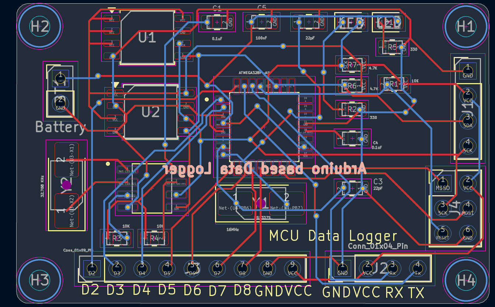
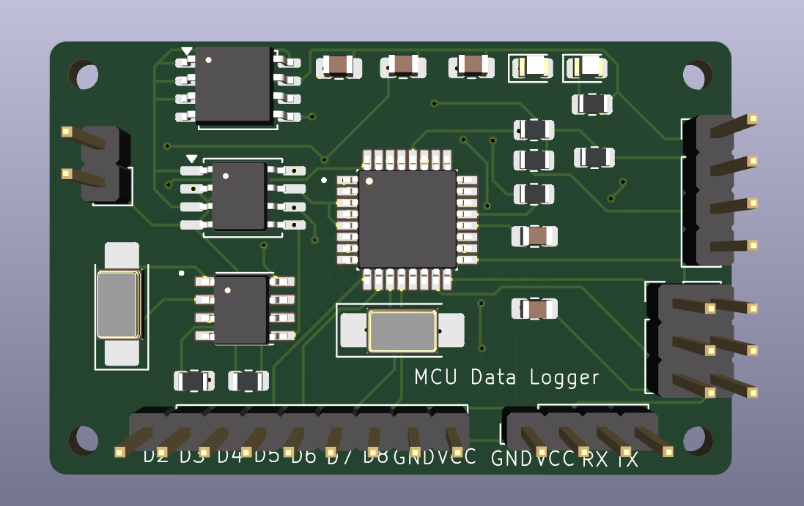
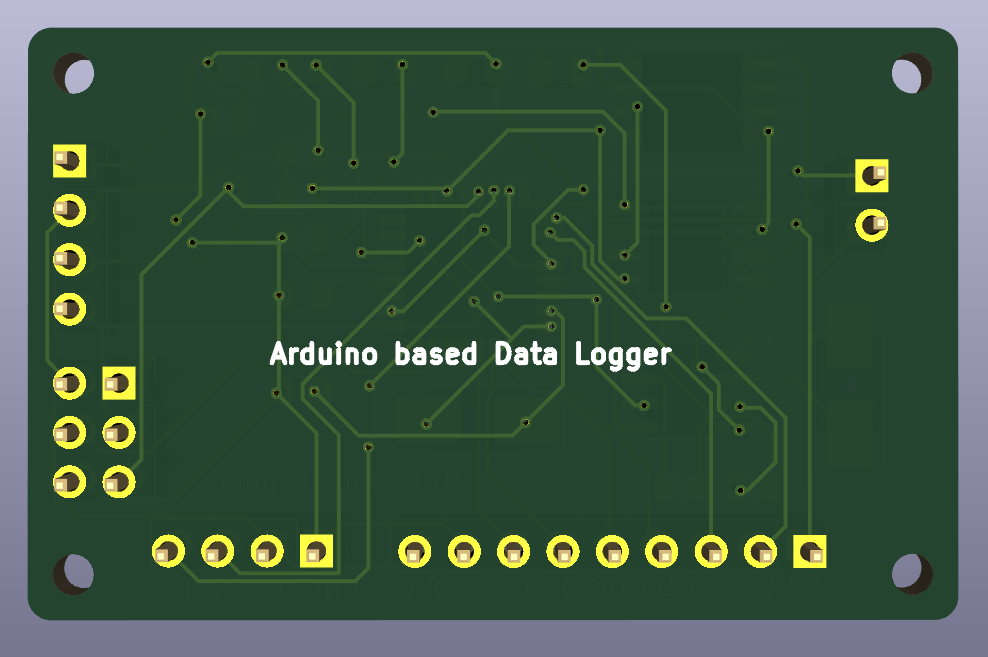
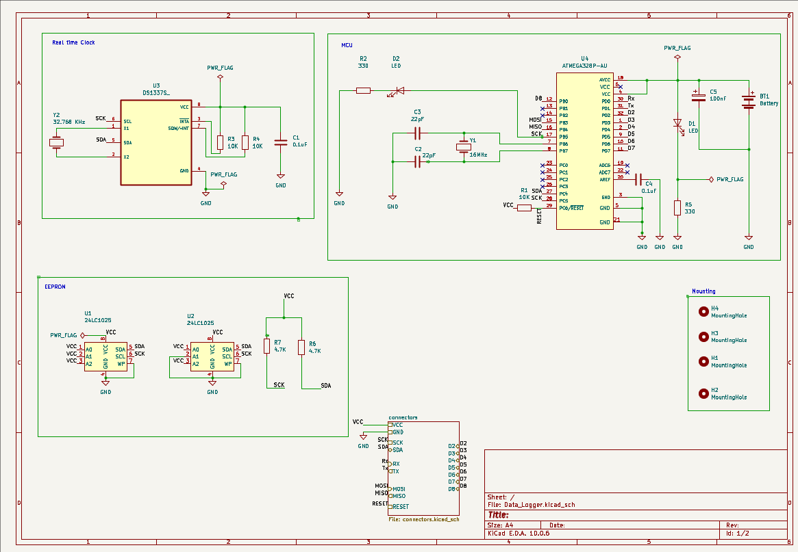

# 2-Layer PCB for MCU Data Logger

A 2-layer PCB designed in KiCad 10 for logging data using an MCU-based system and communication interfaces.

## Images

### PCB Layout


### 3D View (Front)


### 3D View (Back)


### Schematic


## Overview

- **Board:** 2-layer, [50] x [30] mm
- **MCU / main ICs:** [e.g. ATmega328P-AU, EEPROM module, RTC, etc.]
- **Interfaces:** [e.g. I2C, UART]
- **Power:** [e.g. 5 V via Connector]
- **EDA tool:** KiCad 10.0

## Repository Structure

```
.
├── Data_Logger/     # KiCad project (schematics, PCB layout, fp-lib-table) and Gerber files
├── Images/          # Layout, 3D renders and schematic images used in this README
├── .gitignore
└── README.md
```

## Opening the Project

1. Install [KiCad 10](https://www.kicad.org/download/).
2. Clone this repository:
   ```
   git clone https://github.com/Md-Gulab/2-Layer-PCB-For-MCU-data-logger.git
   ```
3. Open `Data_Logger/Data_Logger.kicad_pro` in KiCad.

## Manufacturing

The Gerber and drill files are exported and ready to upload to a PCB fabricator (JLCPCB, PCBWay, etc.).

| Setting | Value |
|---|---|
| Layers | 2 |
| Board thickness | 1.6 mm |
| Surface finish | [HASL / ENIG] |
| Copper weight | 1 oz |


## Author

**Md Gulab**
